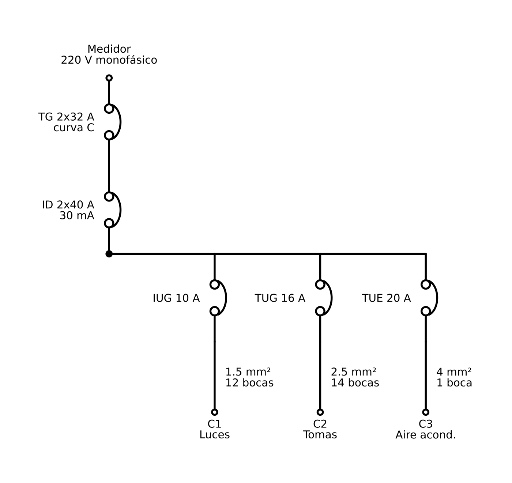

# Tablerista · Simulador de instalación eléctrica domiciliaria

Simulador web de una instalación eléctrica **monofásica de 220 V** para vivienda, basado en los criterios de la reglamentación argentina **AEA 90364-7-771**. Permite armar el tablero, cargar circuitos y artefactos, provocar fallas y ver en tiempo real qué protección actúa y por qué, tanto en una vista de tablero con esquema unifilar como en una **vista 3D de la casa** con cañerías, bocas y artefactos.

> **Herramienta didáctica.** Los valores de capacidad de cables y los tiempos de disparo son aproximados. Un proyecto real lo calcula y firma un electricista matriculado según AEA 90364.



---

## Índice

- [Qué podés hacer](#qué-podés-hacer)
- [Inicio rápido](#inicio-rápido)
- [Scripts disponibles](#scripts-disponibles)
- [Las dos vistas](#las-dos-vistas)
- [Cómo se modela la física](#cómo-se-modela-la-física)
- [Validaciones AEA](#validaciones-aea)
- [Formato del JSON de la instalación](#formato-del-json-de-la-instalación)
- [Persistencia](#persistencia)
- [Arquitectura del código](#arquitectura-del-código)
- [Tests y verificaciones](#tests-y-verificaciones)
- [Script Python: esquema unifilar](#script-python-esquema-unifilar)
- [Compatibilidad, accesibilidad y rendimiento](#compatibilidad-accesibilidad-y-rendimiento)
- [Limitaciones conocidas](#limitaciones-conocidas)

---

## Qué podés hacer

- **Tablero completo:** térmica general, interruptor diferencial y una termomagnética por circuito, con palancas que se bajan, se rearman y disparan solas.
- **Circuitos IUG, TUG y TUE** (y otros tipos), cada uno con su térmica (amperes y curva B, C o D), sección de cable, cantidad de bocas y lista de cargas.
- **Artefactos encendibles** desde un catálogo: heladera, pava, microondas, estufa, aire acondicionado, termotanque, lavarropas y más. Cada uno tiene potencia y factor de potencia.
- **Fallas:**
  - fuga de aislación con corriente configurable en mA (en la vista 3D se puede elegir la boca o el artefacto),
  - cortocircuito con disparo magnético inmediato.
- **Simulación en el tiempo:**
  - calentamiento del bimetal hasta el disparo térmico,
  - temperatura del cable,
  - energía consumida,
  - velocidad ×1, ×10, ×60 o ×300.
- **Esquema unifilar en vivo** que muestra por dónde circula corriente y qué está disparado.
- **Verificación del proyecto** según AEA: sección contra protección, máximo de bocas, puesta a tierra, grado de electrificación y más.
- **Vista 3D interactiva:**
  - casa generada automáticamente, con el recorrido de cada cañería y las bocas,
  - luces que se encienden y artefactos con su estado,
  - colores según la carga del circuito,
  - trazo animado de la fuga hacia la jabalina.
- **Edición en vivo:** cualquier parámetro se puede cambiar con la simulación corriendo, desde cualquiera de las dos vistas.
- **Restablecer un circuito** a la configuración del proyecto cargado con un solo botón.
- **Configuración en JSON:** se puede editar, copiar, importar desde archivo y exportar.
- **Tema claro y oscuro** automático, y diseño adaptado a celular, tablet y escritorio.

---

## Inicio rápido

Requisitos: **Node.js 20** o superior y npm.

```bash
git clone https://github.com/gst14/electricidad-domiciliaria-simulador.git
cd electricidad-domiciliaria-simulador
npm install
npm run dev
```

Abrí la URL que muestra Vite (por defecto `http://localhost:5173`). La app arranca con una casa de ejemplo de 95 m² y tres circuitos.

Para la versión de producción:

```bash
npm run build     # typecheck + build + verificación del bundle
npm run preview   # sirve la carpeta dist/
```

---

## Scripts disponibles

| Comando | Qué hace |
|---|---|
| `npm run dev` | Servidor de desarrollo con recarga en caliente. |
| `npm run build` | Chequeo de tipos (`tsc`), build de producción y verificación de que three.js **no** quede en el bundle inicial. |
| `npm run preview` | Sirve el build de `dist/` para probarlo localmente. |
| `npm test` | Corre los tests unitarios y de integración con Vitest. |
| `npm run lint` | ESLint sobre todo el proyecto. |
| `npm run typecheck` | Solo el chequeo de tipos de TypeScript. |

---

## Las dos vistas

Se cambia entre vistas con las pestañas **Tablero** y **Vista 3D**. También se puede entrar directo por URL: `#tablero` o `#3d`. Las dos vistas comparten el mismo estado: lo que cambiás en una se ve al instante en la otra, y cambiar de vista no reinicia la simulación.

### Vista Tablero

- **Encabezado:** pausa y reanudación, velocidad de simulación y *Rearmar todo*.
- **Barra de estado:** resume la situación (todo energizado, sobrecarga en curso, qué disparó y qué hacer).
- **Medidor:** corriente total, potencia, energía en kWh, fuga a tierra y tiempo simulado.
- **Tablero principal:** tocá una palanca para abrirla o rearmarla. La barra naranja de cada módulo muestra el calentamiento del bimetal; cuando se llena, la térmica dispara. El diferencial tiene su botón de prueba **T**.
- **Esquema unifilar en vivo:** medidor, TG, ID y un ramal por circuito, con la puesta a tierra.
- **Fichas de circuito:**
  - corriente contra In e Iz,
  - estado del bimetal y del cable,
  - lista de cargas con interruptor, alta y baja de cargas,
  - fallas de aislación (sana, humedad 15 mA, falla 60 mA) y cortocircuito,
  - botón **↺ Restablecer**.
- **Verificación del proyecto** y **registro de eventos**.
- **Editor JSON:** aplicar cambios, copiar, cargar archivo y restaurar el ejemplo. Incluye una explicación de cómo se modela cada fenómeno.

### Vista 3D

Se carga recién cuando la abrís (*lazy loading*), así que no agrega peso a la carga inicial de la app.

**Qué muestra**

- **Casa procedural:** ambientes distribuidos según la superficie del JSON, con muros, pisos y techo ocultable.
- **Tablero** empotrado con TG, ID y una térmica por circuito. Las palancas suben y bajan con animación. **Tocar una palanca la abre o la rearma**, igual que en la otra vista.
- **Cañerías:** recorridos ortogonales desde el tablero, subiendo al cielorraso, por el techo y bajando a cada boca. Cada circuito tiene su color.
- **Flujo de corriente** animado sobre cada caño. Su velocidad es proporcional a la corriente.
- **Bocas:** centros, llaves, tomas y bocas dedicadas.
- **Luminarias** que se encienden con brillo.
- **Artefactos** simplificados, con etiqueta. La etiqueta se pone **verde cuando el artefacto está funcionando**.

**Colores según el estado eléctrico**

| Situación | Cómo se ve |
|---|---|
| Carga < 60 % de la térmica | Color del circuito |
| 60 – 90 % | Ámbar |
| 90 – 100 % | Naranja con pulso suave |
| > 100 % (sobrecarga) | Rojo con pulso rápido y tiempo estimado hasta el disparo |
| Térmica disparada o sin tensión | Gris, sin flujo, luces y artefactos apagados |
| Cable subdimensionado (In > Iz) | Rayado rojo sobre la cañería |
| Corriente mayor a lo que soporta el cable (I > Iz) | Halo rojo pulsante |
| Fuga de aislación | Pulso rojo en la boca y trazo animado hasta la jabalina |
| Fuga sin jabalina | Halo de "carcasa con tensión" alrededor del artefacto |
| Cortocircuito | Destello en la boca y disparo inmediato |

Además del color, cada estado se indica con texto: "DISPARADA", "82 %", avisos en el panel.

**Controles**

- **Sobre la escena:** play/pausa, velocidad, *Reiniciar estado* y tiempo simulado.
- **Barra inferior:**
  - modo **rayos X** (muros semitransparentes, las cañerías se ven a través),
  - **corte a 1,20 m** (vista tipo plano),
  - techo y *solo circuito seleccionado*,
  - menú de **capas** (casa, cañerías, bocas, artefactos, luminarias, etiquetas),
  - cámaras: isométrica, planta, frente del tablero e *ir al ambiente*.
- **Selección:** tocá una cañería, boca, artefacto o palanca. Se resalta todo su circuito, se atenúa el resto y el panel salta a esa sección. Al pasar el mouse aparece un tooltip con corriente, potencia, protección y sección.

**Panel de parámetros**

En escritorio es un panel lateral colapsable; en celular, un panel inferior que se arrastra entre tres alturas. Tiene tres pestañas:

1. **Circuitos:**
   - amperes y curva de la térmica, sección del cable, cantidad de bocas,
   - cargas (encender, potencia, agregar, quitar),
   - indicadores en vivo, avisos AEA del circuito y botón **↺ Restablecer**.
2. **Tablero:** térmica general, diferencial (corriente y sensibilidad), puesta a tierra (jabalina y resistencia) y rearme de cada protección.
3. **Fallas:** inyectar una fuga eligiendo circuito, boca o artefacto y corriente en mA; provocar un cortocircuito; limpiar fallas.

Todos los cambios se aplican con la simulación corriendo, sin reiniciar la escena ni mover la cámara.

---

## Cómo se modela la física

Toda la lógica eléctrica vive en un único módulo puro, [`src/domain/simulacion/sim.js`](src/domain/simulacion/sim.js), sin dependencias del DOM ni de three.js. Las dos vistas lo consumen.

- **Corriente de cada artefacto:** `I = P ÷ (V × fp)`. Los motores (heladera, aire, bomba, lavarropas) tienen factor de potencia menor a 1.
- **Disparo térmico:** el bimetal acumula calor cuando la corriente supera 1,13 × In. La velocidad de calentamiento crece con el cuadrado de la sobrecarga, así que una sobrecarga mayor dispara antes. Sin sobrecarga, el bimetal se enfría.
- **Disparo magnético:** es instantáneo cuando la corriente supera el múltiplo de la curva: **B = 4 × In**, **C = 8 × In**, **D = 15 × In**.
- **Selectividad:** en un cortocircuito dispara la térmica del circuito, no la general.
- **Diferencial:** no mira la corriente total sino la fuga a tierra. Dispara cuando la fuga alcanza el **75 % de su sensibilidad** (22,5 mA para uno de 30 mA) y corta toda la casa.
- **Sin puesta a tierra:** la fuga no encuentra camino a tierra, el diferencial no la detecta y la carcasa del artefacto queda con tensión.
- **Temperatura del cable:** tiende a `30 °C + 40 °C × (I ÷ Iz)²`. Si la térmica es más grande que lo que soporta el cable, el cable pasa los **70 °C** del PVC antes de que la protección actúe.

Capacidad aproximada de los cables (Iz, PVC en cañería):

| Sección (mm²) | 1 | 1,5 | 2,5 | 4 | 6 | 10 | 16 | 25 |
|---|---|---|---|---|---|---|---|---|
| Iz (A) | 12 | 15 | 21 | 28 | 36 | 50 | 66 | 84 |

---

## Validaciones AEA

La sección *Verificación del proyecto* (y los avisos de cada circuito en la vista 3D) revisa:

- El diferencial tiene que ser de **30 mA o menos** para proteger personas.
- El diferencial no debería ser de menor corriente que la térmica general.
- **Puesta a tierra:**
  - tiene que existir,
  - más de 40 Ω es error,
  - más de 10 Ω es aviso.
- **Sección contra protección:** la térmica no puede superar el Iz del cable.
- **Secciones mínimas:** 1,5 mm² para iluminación y 2,5 mm² para tomas.
- **Máximo de 15 bocas** por circuito de uso general (IUG y TUG).
- **Selectividad:** la térmica del circuito tiene que ser menor que la general.
- **Consumo:** aviso si con todo encendido se supera la térmica del circuito.
- **Circuitos obligatorios:** al menos uno de iluminación (IUG) y uno de tomas (TUG).
- **Grado de electrificación por superficie**, con la cantidad mínima de circuitos de cada grado:

| Superficie | Grado | Circuitos mínimos |
|---|---|---|
| hasta 60 m² | mínimo | 2 |
| hasta 130 m² | medio | 3 |
| hasta 200 m² | elevado | 5 |
| más de 200 m² | superior | 6 |

---

## Formato del JSON de la instalación

La instalación completa se describe en un JSON que se puede editar desde la app. Ejemplo: [`instalacion.json`](instalacion.json).

```jsonc
{
  "vivienda": "Casa ejemplo 95 m2",
  "tension_v": 220,                    // o "tension": "220 V monofásico"
  "superficie_m2": 95,
  "grado_electrificacion": "medio",
  "tablero": {
    "termica_general": { "polos": 2, "amperes": 32, "curva": "C" },
    "diferencial":     { "polos": 2, "amperes": 40, "sensibilidad_ma": 30 }
  },
  "puesta_tierra": { "jabalina": true, "resistencia_ohm": 10 },
  "circuitos": [
    {
      "id": "C2", "tipo": "TUG", "descripcion": "Tomas",
      "amperes": 16, "curva": "C", "seccion_mm2": 2.5, "bocas": 14,
      "cargas": [
        { "nombre": "Heladera", "potencia_w": 150, "fp": 0.8, "encendida": true },
        { "nombre": "Pava eléctrica", "potencia_w": 2000, "encendida": false }
      ]
    }
  ]
}
```

| Campo | Obligatorio | Notas |
|---|---|---|
| `tablero.termica_general`, `tablero.diferencial` | Sí | `amperes` > 0. La curva por defecto es C; la sensibilidad por defecto, 30 mA. |
| `circuitos` | Sí, al menos uno | Cada uno necesita `amperes` > 0. El resto tiene valores por defecto. |
| `tension_v` / `tension` | No | 220 V por defecto. |
| `superficie_m2` | No | Hace falta para verificar el grado de electrificación y para generar la casa 3D. |
| `puesta_tierra` | No | Por defecto, con jabalina. |
| `cargas[].fp` | No | Factor de potencia; 1 si se omite. |
| `layout3d` | No | Ver abajo. |

### Clave opcional `layout3d`

Si el JSON no la trae, la casa 3D se **genera automáticamente**, siempre igual para el mismo JSON. Si la trae, se respetan las posiciones indicadas, lo que permite describir una casa real:

```jsonc
"layout3d": {
  "ambientes": [ { "id": "A1", "nombre": "Living", "x": 0, "z": 0, "ancho": 4, "largo": 5, "alto": 2.6 } ],
  "tablero":   { "posicion": [0.6, 1.5, 0.02], "ambienteId": "A1" },
  "bocas": [
    { "id": "C1-b01", "circuitoId": "C1", "tipo": "centro", "ambienteId": "A1",
      "posicion": [2, 2.6, 2.5], "normal": [0, -1, 0], "cargaIndex": 0 }
  ],
  "recorridos": [ { "circuitoId": "C1", "puntos": [[0.6, 1.5, 0.02], [0.6, 2.5, 0.02]] } ]
}
```

- Las medidas están en metros: `x`/`z` es la esquina del ambiente en planta e `y` es la altura.
- `tipo` de boca: `centro`, `aplique`, `toma`, `llave` o `caja_paso`.
- `cargaIndex` vincula la boca con `circuitos[i].cargas[cargaIndex]`.
- `recorridos` es opcional. Si falta, se calcula un ruteo ortogonal por el cielorraso.
- Si cambia la cantidad de bocas de un circuito, solo se regeneran las de ese circuito y se conservan las posiciones existentes.

El formato es **retrocompatible**: cualquier JSON anterior sigue funcionando, y la app solo agrega `layout3d` al exportar si el JSON ya lo traía.

---

## Persistencia

Todo se guarda en el navegador (`localStorage`), sin servidor:

| Clave | Contenido |
|---|---|
| `tablerista-cfg` | La configuración actual, con tus cambios. Se guarda en cada edición. |
| `tablerista-base` | El proyecto tal como se cargó (último JSON aplicado o el ejemplo). Es la referencia del botón **Restablecer**. |

El estado de la simulación (protecciones disparadas, fallas inyectadas, tiempo simulado) no se guarda: al recargar la página arranca de nuevo.

---

## Arquitectura del código

Sigue una separación por capas: **el dominio no conoce a las vistas**.

```
src/
├─ domain/
│  ├─ simulacion/        Motor eléctrico puro: corrientes, disparos, diferencial,
│  │                     temperatura, validaciones AEA (sim.js + tipos)
│  └─ layout3d/          Generación de la casa y de las bocas (generarLayout.ts)
│                        y ruteo ortogonal de cañerías (ruteo.ts)
├─ store/
│  └─ simStore.ts        Fuente única de verdad (zustand): config, estado de
│                        simulación, acciones, reloj de 100 ms y persistencia
├─ components/           Vista Tablero (React): tablero, unifilar, fichas,
│                        paneles, editor JSON
├─ views/vista3d/        Vista 3D (carga diferida)
│  ├─ Vista3D.tsx        Canvas, luces, Bloom/Outline, render bajo demanda
│  ├─ escena/            Casa, Tablero, Cañerías, Bocas, Luminarias,
│  │                     Artefactos, Fallas, Cámaras, Tooltip
│  ├─ panel/             Panel de parámetros, pestañas e inspector
│  ├─ mapeoVisual.ts     Funciones puras: estado eléctrico → color, pulso, flujo
│  └─ BarraVista.tsx, ControlesSim.tsx, colores.ts, geometria.ts
├─ App.jsx, main.jsx     Pestañas de vista y arranque de la simulación
└─ styles.css            Tokens de diseño (tema claro/oscuro) y estilos
```

**Puntos clave**

- **Un solo store.** La configuración (inmutable) y el estado de la simulación (mutable, con un contador `version`) viven en `simStore`. Las dos vistas leen y escriben ahí.
- **Escena 3D eficiente.** La escena no se vuelve a renderizar con React en cada tick: lee el store en cada frame y actualiza materiales e instancias.
- **Render bajo demanda.** Se usa `frameloop="demand"`: con la simulación en pausa y sin interacción no se dibuja ningún frame.
- **Colores por circuito.** Salen de los tokens `--c1` a `--c8` del tema y son los mismos en las dos vistas. Evitan los tonos de alarma (ámbar, naranja y rojo), salvo C1, que mantiene el amarillo del tema.
- **Stack:**
  - React 19 y Vite 6,
  - TypeScript para el código nuevo (el código original sigue en JavaScript),
  - zustand,
  - three.js con @react-three/fiber, drei y postprocessing,
  - Vitest y ESLint.
- **Depuración en desarrollo:**
  - `?debug` en la URL abre un panel con [leva](https://github.com/pmndrs/leva) para ajustar efectos y resolución,
  - el store queda accesible desde la consola como `window.__tablerista`.

  Ninguna de las dos cosas se incluye en el build de producción.

---

## Tests y verificaciones

```bash
npm test
```

Cubren:

- **Store:**
  - encender cargas y cambiar amperes recalcula la simulación,
  - una sobrecarga dispara por efecto térmico,
  - una fuga hace disparar el diferencial,
  - rearmes,
  - el botón Restablecer,
  - paridad con el comportamiento original del motor.
- **`generarLayout`:** determinismo, cantidad exacta de bocas, alturas por tipo, bocas dentro de su ambiente, conservación de posiciones editadas y JSON mal formado.
- **`ruteo`:** solo tramos ortogonales, arranca en el tablero y termina en la boca, carriles separados por circuito.
- **`mapeoVisual`:** umbrales de carga (59/60/90/100/101 %), protecciones disparadas, Iz, fugas, puesta a tierra y movimiento reducido.
- **Retrocompatibilidad:** el JSON de ejemplo sin `layout3d` se carga y el JSON exportado mantiene las claves que usa `unifilar.py`.

`npm run build` además verifica, con [`scripts/verificar-bundle.mjs`](scripts/verificar-bundle.mjs), que three.js quede fuera del bundle inicial.

---

## Script Python: esquema unifilar

[`unifilar.py`](unifilar.py) genera un esquema unifilar en SVG a partir del mismo JSON y muestra avisos básicos: más de 15 bocas, o una térmica de circuito que iguala o supera a la general.

```bash
pip install schemdraw
python unifilar.py instalacion.json   # genera unifilar.svg
```

El script ignora las claves que no conoce, así que funciona con JSON que incluyan `layout3d`. Lee `tension` como texto (por ejemplo `"220 V monofásico"`), así que el JSON tiene que traer esa clave.

---

## Compatibilidad, accesibilidad y rendimiento

- **Navegadores:** versiones actuales de Chrome, Edge, Firefox y Safari. La vista 3D necesita WebGL 2.
- **Celular y tablet:**
  - controles táctiles de al menos 40 px,
  - campos de 16 px (iOS no hace zoom al tocarlos),
  - en la vista 3D, panel inferior arrastrable y barras de controles que se deslizan de costado,
  - sin scroll horizontal.
- **Accesibilidad:**
  - todo lo que se hace tocando en 3D también se puede hacer desde el panel con teclado o lector de pantalla,
  - los estados no se transmiten solo con color,
  - se respeta `prefers-reduced-motion`: sin flujo ni pulsos animados y con cámara instantánea.
- **Tema:** claro y oscuro según el sistema operativo, con tokens de diseño compartidos.
- **Rendimiento en 3D:**
  - bocas instanciadas y raycasting acelerado con BVH,
  - en equipos lentos baja la resolución y apaga los efectos automáticamente,
  - el Outline solo se calcula cuando hay algo seleccionado.

---

## Limitaciones conocidas

- Los valores son **aproximados y con fines didácticos**: no reemplazan un cálculo según AEA 90364.
- La fuga se modela **por circuito**. Elegir una boca en la vista 3D solo ubica el efecto visual.
- La resistencia de la puesta a tierra no cambia la simulación. Se usa para los avisos de la verificación: más de 10 Ω es aviso, más de 40 Ω es error.
- En la vista 3D no se pueden arrastrar las bocas. Para ubicarlas a mano hay que cargar `layout3d` en el JSON.
- [`Tablerista.html`](Tablerista.html) es una versión anterior, de un solo archivo y sin vista 3D. Se conserva como referencia y no forma parte de la app de Vite.
